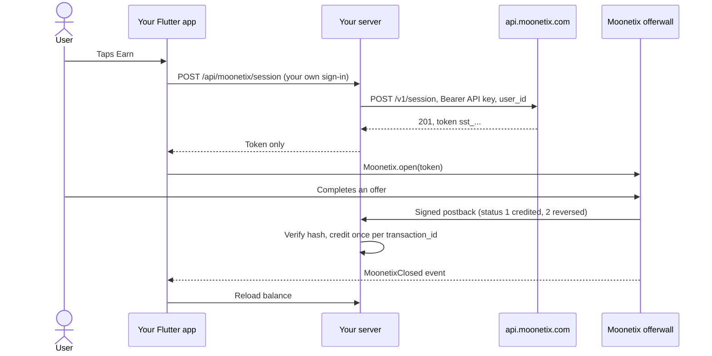

# Moonetix Offerwall for Flutter

**Open the Moonetix offerwall in your Flutter app on Android and iOS with one call, from a single-use token your server creates.**

[](https://github.com/moonetix/moonetix-flutter/actions/workflows/ci.yml)
[](https://moonetix.com)
[](LICENSE)
[](https://docs.moonetix.com/flutter-sdk#install)
[](https://docs.moonetix.com/flutter-sdk)
[](https://moonetix.com/register?from=github-moonetix-flutter)
[](https://moonetix.com/integrations/flutter)

This is the source of the `moonetix_offerwall` plugin for [Moonetix](https://moonetix.com). It uses the native Moonetix Android and iOS SDKs: the offerwall opens in a locked-down native screen, offer links go to the store or the browser, and a few typed events come back to your Dart code. Moonetix is an affiliate network: your users earn your own currency by completing offers, and you earn per completed offer.

The source matches the released 2.0.1 plugin. For apps, install it from the Moonetix pub repository as shown below.

> **Get your App ID and API key: sign up free at https://moonetix.com/register?from=github-moonetix-flutter**

## What the plugin gives you

One Dart API over two native SDKs, with the same options, events and error codes on Android and iOS. Web and desktop report `unsupported` instead of failing, so a single code path covers every platform. The app only ever holds a session token that works once and expires after 10 minutes; the API key and link hash salt stay on your server.

The analyzer runs with strict casts and strict raw types and reports no issues. CI runs it with the 24 plugin tests and the example's widget tests on Flutter 3.44.0.

## How it fits together



## Quick start

### 1. Install

Flutter 3.27 or newer. The plugin is in the Moonetix package repository. Add it to your `pubspec.yaml` and run `flutter pub get`:

```yaml
dependencies:
  moonetix_offerwall:
    hosted: https://moonetix.com/pub
    version: ^2.0.1
```

- **iOS:** nothing to add. The plugin brings the Moonetix iOS SDK with it, for CocoaPods and for Swift Package Manager. Build with Xcode 16 or newer.
- **Android:** nothing else to add. The plugin brings the Moonetix Maven repository, the Android SDK and its R8 rules with it. If your `android/settings.gradle` blocks project repositories (`repositoriesMode`), add `maven { url = uri("https://moonetix.com/maven") }` to its `dependencyResolutionManagement` repositories.

### 2. Add a token endpoint to your server

The app never calls `POST https://api.moonetix.com/v1/session` itself, because that call needs the API key. Your server checks who is signed in, asks Moonetix for a session for that user ID, and returns only the token. Copy the endpoint from the [docs](https://docs.moonetix.com/android-sdk#token-endpoint) (Node.js, PHP and Python), or start from the tested Node.js version in [moonetix-ios-sdk/token-endpoint](https://github.com/moonetix/moonetix-ios-sdk/tree/main/token-endpoint), which serves every Moonetix SDK.

The API key is on the API page of your dashboard and belongs in the server environment only (see [`.env.example`](.env.example)). If Moonetix answers 403 (`app_not_live` or `user_blocked`), hide the Earn button.

### 3. Open the offerwall

Call `init` once with the App ID from the Integration section. Then open the offerwall with a fresh token from your server.

```dart
import 'package:moonetix_offerwall/moonetix_offerwall.dart';

void main() {
  WidgetsFlutterBinding.ensureInitialized();
  Moonetix.init('YOUR_APP_ID');
  runApp(const MyApp());
}

// When the user taps Earn, with a token from your server:
await Moonetix.open(token);
```

Ask your token endpoint for the token with your own sign-in credential (uses the `http` package):

```dart
Future<String> fetchMoonetixToken(String authToken) async {
  final response = await http
      .post(
        Uri.parse('https://your-server.example/api/moonetix/session'),
        headers: {'Authorization': 'Bearer $authToken'},
      )
      .timeout(const Duration(seconds: 10));
  if (response.statusCode != 200) {
    throw Exception('Token request failed: HTTP ${response.statusCode}');
  }
  return (jsonDecode(response.body) as Map<String, dynamic>)['token'] as String;
}
```

`open` never throws for offerwall problems. They arrive as events. To set the title or color yourself, or to hide the mark, pass `options: const MoonetixOptions(title: 'Earn coins', toolbarColor: Color(0xFF004ABB), showLogo: false)`.

## Events

```dart
Moonetix.events.listen((MoonetixEvent event) {
  switch (event) {
    case MoonetixOpened():
      break;
    case MoonetixClosed():
      refreshBalance();
    case MoonetixErrorEvent(:final MoonetixError error):
      debugPrint('${error.code.name}: ${error.message}');
  }
});
```

`Moonetix.events` is a broadcast stream that does not keep events for later, so start listening before you call `open`. Prefer callbacks? `Moonetix.setListener(MoonetixListener(onOpened: ..., onClosed: ..., onError: ...))` works like the Android listener.

| Event | When |
| --- | --- |
| `MoonetixOpened` | The offerwall finished loading. |
| `MoonetixClosed` | The user closed the offerwall. Reload the user's balance from your server here. |
| `MoonetixErrorEvent` | `notInitialized`, `invalidAppId`, `invalidToken`, `tokenExpiredOrUsed`, `network`, `unsupported` or `unknown`. Create a new session and try again. |

Events are for your user interface only. Credit rewards from the signed postback on your server, never from an event.

## Troubleshooting

| What you see | Cause and fix |
| --- | --- |
| `invalidAppId`: "The app ID passed to Moonetix.init() is invalid" | The value is not the 24-character lowercase hex App ID. Passing the API key here is the usual mistake. |
| `invalidToken` right after `open` | You passed the whole JSON answer or an empty string. Pass only the `token` field, which starts with `sst_`. |
| `invalidToken` after the screen opened | The token was created with the API key of another app than the App ID in `init`. |
| `tokenExpiredOrUsed` | The token is older than 10 minutes or was opened twice. Request a new token on every tap. |
| `unsupported` on Android or iOS | The native side is not in the running build. Stop the app and build it again: hot reload and hot restart do not add plugins. On web and desktop `unsupported` is expected. |
| Your endpoint gets 403 `app_not_live` or `user_blocked` | The app is paused or not approved yet, or the user is blocked. Hide the Earn button. |
| A "VPN detected" page instead of offers | The device is on a VPN, a proxy or a cloud network. Test on a normal home or mobile connection. |

## Under the hood

1. `Moonetix.init` checks the App ID format in Dart and passes it to the native SDK.
2. `Moonetix.open` checks the token format (`sst_` plus 43 characters), then calls the native SDK over a method channel. On web and desktop it reports `unsupported`.
3. On Android, the plugin uses `com.moonetix:offerwall:2.0.1` from `https://moonetix.com/maven` (the repository is added only for the `com.moonetix` group). On iOS, it uses `MoonetixOfferwall.xcframework` 2.0.1. Both native SDKs keep only `wall.moonetix.com` pages inside the offerwall screen and open every other link outside the app.
4. Native events come back over the same channel and are mapped to typed Dart events and error codes.
5. Rewards never pass through the app. Moonetix calls your postback URL, and your server credits the user.

| Path | Purpose |
| --- | --- |
| `lib/src/moonetix.dart` | Public API: `init`, `open`, `events`, `setListener` |
| `lib/src/types.dart`, `lib/src/validation.dart` | Options, events, error codes, input checks |
| `lib/src/method_channel.dart`, `lib/src/platform_interface.dart` | Platform channel |
| `android/` | Java bridge to the Android SDK, with JUnit tests |
| `ios/` | Swift bridge to the iOS SDK, CocoaPods and Swift Package Manager manifests, privacy manifest |
| `example/` | Demo app: enter an App ID, paste a token, open the offerwall |
| `tool/fetch-ios-sdk.sh` | Downloads and checks the iOS SDK binary for builds from this source |

## Security

- Create sessions on your server only. Never put the API key or the link hash salt in your app: anyone can read an app's files.
- Take the user ID from your own sign-in, never from the request. Otherwise anyone could open the offerwall as someone else.
- Return only the token to the app, and create a new one each time the user taps Earn.
- The token only passes through memory. The plugin never logs it, and there is no JavaScript bridge into your app.
- Credit rewards only from the signed server-to-server postback: verify the hash with a constant-time comparison first, credit each `transaction_id` once, and let status 2 take back only what was credited. See [offerwall-postback-handlers](https://github.com/moonetix/offerwall-postback-handlers).
- Reward users only for completed offers. Never reward joins, invites, likes, reviews or other engagement. Users must be 16 or older.

**Store privacy.** Declare User ID, Device ID, Coarse Location and Product Interaction for App Functionality, linked to the user and not used for tracking, in App Store Connect and in the Google Play Data safety form. See [App Store privacy details](https://docs.moonetix.com/ios-sdk#privacy).

## Development

### From this source

```bash
flutter pub get
flutter analyze
flutter test
cd example && flutter pub get && flutter analyze && flutter test
```

The iOS SDK binary is not in this repository. To build the iOS side from this source, run `sh tool/fetch-ios-sdk.sh` from the repository root first: it downloads `MoonetixOfferwall-2.0.1.xcframework.zip` from moonetix.com, checks its SHA-256 and unpacks it to `ios/moonetix_offerwall/Frameworks/`.

### On a device

1. Create a session for a test user from your server, and open it in a debug build on an Android phone, an iPhone or the iOS Simulator. After adding the plugin, stop the app and build it again: hot reload does not add native code.
2. Check that the offerwall opens, that an offer opens in the store or the browser, and that back and close work.
3. In the dashboard, open Offerwalls, your offerwall, Integration, and click **Send a test postback**. You can also send one from the Postback page. Send status 1, then status 2 for the same user, and check that the balance goes up and back down.
4. Test on a normal home or mobile connection. On a VPN, a proxy or a cloud device the offerwall shows a block page instead of offers.

For error codes and fixes, see [Troubleshooting](https://docs.moonetix.com/flutter-sdk#troubleshooting) and [Testing](https://docs.moonetix.com/testing).

## Learn more

- Docs: [Flutter SDK](https://docs.moonetix.com/flutter-sdk), [Postbacks](https://docs.moonetix.com/postbacks), [Credits and reversals](https://docs.moonetix.com/credits-and-reversals), [Testing](https://docs.moonetix.com/testing)
- Academy: [How to Add an Offerwall to a Flutter App](https://moonetix.com/academy/integrations/flutter-offerwall)
- Academy: [How to Test Your App Before It Goes Live](https://moonetix.com/academy/integrations/test-your-app-before-launch)
- Moonetix for Flutter: [moonetix.com/integrations/flutter](https://moonetix.com/integrations/flutter)
- Moonetix for apps: [moonetix.com/industries/apps](https://moonetix.com/industries/apps)
- A complete app: [offerwall-flutter-example](https://github.com/moonetix/offerwall-flutter-example)

## Apply as a publisher

**https://moonetix.com/register?from=github-moonetix-flutter** (free). Applications are checked by hand. Once approved, add your app, set the currency name and rate, pass the App ID to `Moonetix.init`, and keep the API key on your server.

## More Moonetix examples

All on [github.com/moonetix](https://github.com/moonetix).

**SDKs**

- [moonetix-android-sdk](https://github.com/moonetix/moonetix-android-sdk): Android SDK source (Kotlin and Java)
- [moonetix-ios-sdk](https://github.com/moonetix/moonetix-ios-sdk): iOS SDK install guide, SwiftUI sample and token endpoint
- [moonetix-react-native](https://github.com/moonetix/moonetix-react-native): React Native and Expo package source
- [moonetix-unity](https://github.com/moonetix/moonetix-unity): Unity plugin source

**Server side**

- [offerwall-postback-handlers](https://github.com/moonetix/offerwall-postback-handlers): postback handlers for common languages
- [offerwall-express](https://github.com/moonetix/offerwall-express), [offerwall-laravel](https://github.com/moonetix/offerwall-laravel), [offerwall-django](https://github.com/moonetix/offerwall-django)
- [offerwall-firebase-functions](https://github.com/moonetix/offerwall-firebase-functions), [offerwall-supabase](https://github.com/moonetix/offerwall-supabase)

**Web and apps**

- [offerwall-nextjs-starter](https://github.com/moonetix/offerwall-nextjs-starter), [offerwall-react-vite](https://github.com/moonetix/offerwall-react-vite), [offerwall-vue-nuxt](https://github.com/moonetix/offerwall-vue-nuxt)
- [rewards-site-starter](https://github.com/moonetix/rewards-site-starter), [moonetix-offerwall-wordpress](https://github.com/moonetix/moonetix-offerwall-wordpress)
- [offerwall-flutter-example](https://github.com/moonetix/offerwall-flutter-example), [offerwall-react-native-example](https://github.com/moonetix/offerwall-react-native-example)
- [offerwall-chrome-extension](https://github.com/moonetix/offerwall-chrome-extension), [offerwall-electron](https://github.com/moonetix/offerwall-electron)

**Games and communities**

- [offerwall-unity-example](https://github.com/moonetix/offerwall-unity-example), [offerwall-godot](https://github.com/moonetix/offerwall-godot), [offerwall-html5-game](https://github.com/moonetix/offerwall-html5-game)
- [telegram-mini-app-offerwall](https://github.com/moonetix/telegram-mini-app-offerwall), [discord-rewards-bot](https://github.com/moonetix/discord-rewards-bot)
- [awesome-offerwalls](https://github.com/moonetix/awesome-offerwalls): a curated list of offerwall resources

## License

Apache License 2.0. See [LICENSE](LICENSE).
